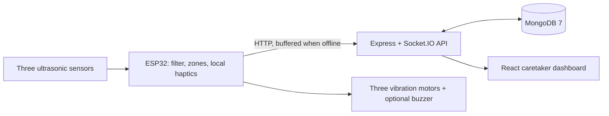

# Smart Mobility Aid

Assumptions: MongoDB is local or provided by the optional MongoDB 7 compose service. Default seeded login passwords are for local demonstration and must be changed before deployment. User records are visible to both authenticated roles; caretaker device access is restricted to assigned devices. The demo endpoint creates simulated readings. Firmware sampling uses a 12 ms echo timeout and a 60 ms scan cadence; local vibration decisions continue offline. Use ESP32 Arduino core 3.x for LEDC PWM. Firmware stamps buffered samples with UTC when NTP has synchronized; without a synchronized clock the server supplies the receipt time. The firmware has not been compiled or exercised on physical hardware in this workspace; the aid supplements a white cane and does not replace it. Distance and latency values are goals only, not measured results.

## Architecture

## Run
1. Install Node.js LTS. For MongoDB, install/run MongoDB 7 locally or from `backend/` run `npm run db:up` (Docker required only for this option).
2. In `backend/`, copy `.env.example` to `.env`, set a random `JWT_SECRET`, run `npm install`, `npm run seed`, then `npm run dev`. Seed login: `admin@example.com` / `ChangeMe123!`; caretaker: `caretaker@example.com` / `ChangeMe123!`. Seed prints the device key once.
3. To run the simulator, set `DEVICE_API_KEY` to that printed key and run `npm run sim` in `backend/`. It sends simulated data every second. Demo start/stop is also in the dashboard.
4. In `frontend/`, copy `.env.example` to `.env`, run `npm install`, `npm run dev`. Open the Vite URL and sign in.
5. Flash firmware: install Arduino IDE, ESP32 board support, and ArduinoJson; copy `firmware/esp32_mobility_aid/config.example.h` to `config.h`, enter Wi-Fi/server/device API key, open the `.ino`, select ESP32 DevKit, and upload. `WIRING.md` has pin and power instructions. Ensure every ECHO signal goes through the stated divider before GPIO.

## API
| Method | Path | Access | Purpose |
|---|---|---|---|
| POST | `/api/auth/login` | Public | JWT login |
| GET | `/api/auth/me` | User | Current profile |
| POST | `/api/readings` | Device | Submit one reading or up to 60 |
| POST | `/api/alerts` | Device | Send caretaker alert |
| GET | `/api/devices/me/config` | Device | Fetch thresholds and haptic settings |
| GET/PATCH | `/api/devices`, `/api/devices/:id/config` | User | List devices / update configuration |
| GET | `/api/readings`, `/api/readings/stats` | User | History and hourly summaries |
| GET/PATCH | `/api/alerts`, `/api/alerts/:id/ack` | User | Filter and acknowledge alerts |
| POST | `/api/demo/start`, `/api/demo/stop` | Admin | Start/stop simulated records |
| GET | `/api/health` | Public | API and database state |

JWT-authenticated Socket.IO clients receive events only for their assigned devices (admins receive all devices). Socket.IO broadcasts `reading`, `alert`, and `device:status`. The service marks a device offline after 15 seconds without a request. Checks: `npm run lint`, `npm test`; run frontend checks with the same commands and `npm run build`.

